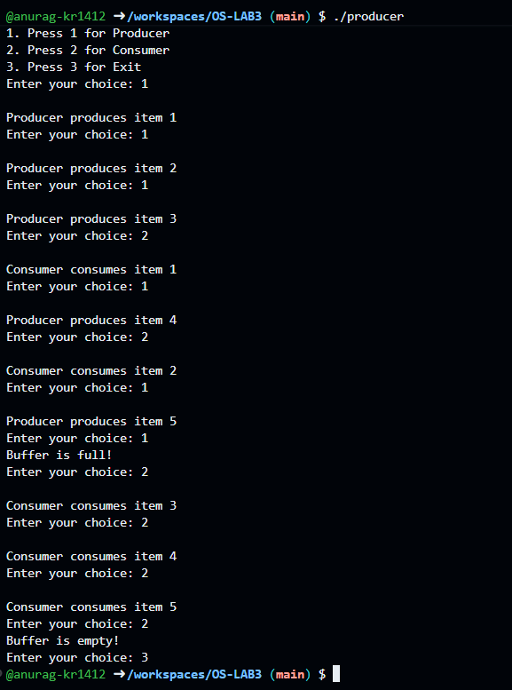

## Experiment 3: Producer-Consumer Problem

### Description
Implementation of the Producer-Consumer Problem using Mutex in C. The producer adds items to the buffer, while the consumer removes items from it.

### Program
`producer.c`

### Output

